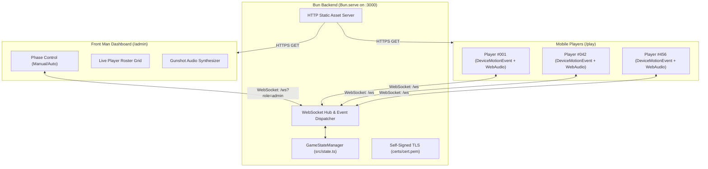

# 🦑 Squid Game: Red Light, Green Light

A self-hosted, real-time party and field game system. Players join from their smartphones over a local Wi-Fi network, detect movement during **Red Light** using the browser's native `DeviceMotionEvent` accelerometer API, and trigger high-volume elimination alarms while synchronizing game state to the Front Man admin dashboard via WebSockets.

---

## 📖 Context & Purpose

This system turns the iconic "Red Light, Green Light" game from Squid Game into an interactive real-world party/field game:
1. **The Arena**: Players stand at the starting line holding their smartphones.
2. **The Front Man (Admin)**: Hosts the game on a laptop or stadium display. The game can run either in **Automatic Mode** (randomized green/red intervals) or **Manual Mode** (host clicks buttons to switch phases).
3. **Green Light**: Players sprint toward the finish line. The phone screen turns green with audio chimes.
4. **Red Light**: Players must freeze immediately!
5. **Elimination**: If a player's phone detects movement past the deceleration grace period (250ms), the phone emits a screeching siren, vibrates aggressively, turns blood red with "ELIMINATED", and notifies the Front Man console with a gunshot audio cue.

---

## 🏗️ Architecture Overview



---

## 📂 Detailed Codebase Structure

```
redgreen/
├── package.json              # Bun configuration, scripts (start, dev, cert, test)
├── tsconfig.json             # TypeScript compiler options
├── generate-cert.sh          # Shell script generating self-signed TLS certs with SAN IPs
├── .gitignore                # Excludes certs/, node_modules/, and system artifacts
├── certs/                    # Auto-generated TLS certificates (gitignored)
│   ├── cert.pem              # Public TLS certificate
│   └── key.pem               # Private key
├── src/
│   ├── types.ts              # Core TypeScript interfaces & WebSocket message contracts
│   ├── state.ts              # GameStateManager: state machine, timers, and player logic
│   └── server.ts             # Bun.serve HTTP/WSS router, static file server, IP detector
├── public/
│   ├── index.html            # Landing page (routing to /play or /admin)
│   ├── play.html             # Mobile player UI (onboarding, calibration, arena, elimination)
│   ├── player.js             # Player motion detection engine, Web Audio synth, WS client
│   ├── admin.html            # Front Man console UI (control bar, settings, player cards)
│   ├── admin.js              # Admin WebSocket controls, live timer, gunshot audio synth
│   └── style.css             # Squid Game dark & neon visual theme (mobile-responsive)
└── tests/
    ├── state.test.ts         # Unit tests for GameStateManager (phases, motion, admin actions)
    └── server.test.ts        # Integration tests verifying static assets and server health
```

### File-by-File Breakdown

#### 1. `src/types.ts`
Defines the shared domain models and message contracts:
- `Player`: `{ id, number, username, status, joinedAt, eliminatedAt, eliminationDelta }`.
- `GamePhase`: `'LOBBY' | 'STARTING' | 'GREEN_LIGHT' | 'RED_LIGHT' | 'ROUND_OVER'`.
- `GameMode`: `'AUTOMATIC' | 'MANUAL'`.
- `GameConfig`: Timing intervals (`minGreen`, `maxGreen`, `minRed`, `maxRed`), `gracePeriodMs`, and `motionThreshold`.
- `ClientMessage` & `ServerMessage`: Discriminated unions for all WebSocket communications.

#### 2. `src/state.ts`
Encapsulates `GameStateManager`:
- **State Machine**: Tracks phase transitions and timers.
- **Player Registry**: Assigns sequential formatted player numbers (`#001`, `#002`, ...). Supports seamless session reconnection if a player refreshes their browser.
- **Motion Violation Handler (`handleMotion`)**:
  - Motion is strictly ignored during `GREEN_LIGHT`, `LOBBY`, `STARTING`, and `ROUND_OVER`.
  - During `RED_LIGHT`, verifies whether `elapsedTime < gracePeriodMs`. If within the grace period, motion is tolerated to allow deceleration. Once past grace, the player is marked `ELIMINATED`.
- **Broadcaster Hook**: Decoupled interface so the state manager triggers WebSocket broadcasts without depending directly on networking internals.

#### 3. `src/server.ts`
Entry point using native `Bun.serve`:
- **TLS Support**: Automatically detects `certs/cert.pem` and `certs/key.pem` to serve over HTTPS/WSS.
- **Network Interface Resolver**: On startup, inspects `os.networkInterfaces()` and logs the exact local LAN IP addresses (e.g., `https://192.168.1.50:3000/play`) for mobile players.
- **WebSocket Gateway**: Routes client messages (`JOIN`, `MOTION_DETECTED`, `ADMIN_*`) to `GameStateManager`.

#### 4. `public/play.html` & `public/player.js`
The mobile browser application:
- **iOS Permission & Audio Unlock**: Features a "⚡ Calibrate & Enter" button that invokes `DeviceMotionEvent.requestPermission()` (required on iOS 13+) and resumes `AudioContext` within the user touch event.
- **Motion Detection Algorithm**:
  $$\Delta = \sqrt{(x - x_{prev})^2 + (y - y_{prev})^2 + (z - z_{prev})^2}$$
- **Audio Synthesizer**: Uses Web Audio API dual oscillators (`sawtooth` + `square` alternating between 800Hz and 1240Hz) so alarm sounds never fail due to missing audio assets.
- **Haptics**: Calls `navigator.vibrate([300, 100, 300, 100, 600])` on elimination.

#### 5. `public/admin.html` & `public/admin.js`
The Front Man control center:
- **Game Controls**: Instant triggers for Green Light, Red Light, 3s Countdown Start, and Reset.
- **Live Roster**: Grid of cards showing alive/eliminated statuses, elimination timestamps, and motion deltas. Includes one-click Revive, Eliminate, and Kick buttons.
- **Stadium Sound**: Synthesizes a realistic gunshot impact sound (filtered white noise decay + sub-bass triangle drop) whenever a player is eliminated.

---

## ⚡ WebSocket Protocol Reference

### Client ➔ Server Messages

| Type | Payload | Description |
|------|---------|-------------|
| `JOIN` | `{ username: string }` | Registers or reconnects a player. |
| `MOTION_DETECTED` | `{ delta: number }` | Sent by player phone when motion exceeds threshold during Red Light. |
| `ADMIN_START` | none | Triggers 3s countdown then starts Green Light. |
| `ADMIN_SET_PHASE` | `{ phase: GamePhase }` | Manually sets phase to `GREEN_LIGHT` or `RED_LIGHT`. |
| `ADMIN_SET_MODE` | `{ mode: 'AUTOMATIC' \| 'MANUAL' }` | Switches between automatic timers and manual host control. |
| `ADMIN_UPDATE_CONFIG` | `{ config: Partial<GameConfig> }` | Updates durations, grace periods, or sensitivity. |
| `ADMIN_RESET` | none | Resets round, sets phase to `LOBBY`, and revives all players. |
| `ADMIN_REVIVE` | `{ playerId: string }` | Revives a specific player. |
| `ADMIN_ELIMINATE` | `{ playerId: string }` | Force-eliminates a player manually. |
| `ADMIN_KICK` | `{ playerId: string }` | Removes a player from the game. |
| `PING` | none | Heartbeat check. |

### Server ➔ Client Messages

| Type | Payload | Description |
|------|---------|-------------|
| `JOIN_SUCCESS` | `{ player: Player, state: GameStateSnapshot }` | Confirms registration and returns assigned player number. |
| `JOIN_ERROR` | `{ message: string }` | Rejection reason (empty name, etc.). |
| `STATE_UPDATE` | `{ state: GameStateSnapshot }` | Broadcast on any player change, phase shift, or config update. |
| `PHASE_CHANGE` | `{ phase: GamePhase, durationMs: number, timestamp: number }` | Broadcast immediately when game phase switches. |
| `PLAYER_ELIMINATED`| `{ player: Player }` | Broadcast when a player is eliminated (triggers audio cues). |
| `PLAYER_REVIVED` | `{ player: Player }` | Broadcast when a player is revived. |
| `PLAYER_KICKED` | `{ playerId: string }` | Sent to notify a kicked player. |
| `PONG` | none | Heartbeat response. |

---

## ⚠️ Critical Gotchas for Developers & Agents

1. **HTTPS / Secure Context Requirement**:
   Modern mobile browsers (iOS Safari 13+ and Chrome on Android) **strictly block `DeviceMotionEvent` on insecure HTTP** unless the host is `localhost`. The Bun server is configured with TLS by default (`certs/cert.pem`). When testing on phones over LAN, users must accept the self-signed certificate.

2. **iOS Safari `requestPermission()` Must Be User-Initiated**:
   `DeviceMotionEvent.requestPermission()` will throw a `NotAllowedError` if called asynchronously or outside a synchronous touch/click event handler. In `player.js`, it is attached directly to the `joinBtn` click handler.

3. **Web Audio Autoplay Policy**:
   Browsers block audio playback until user interaction. The `initAudio()` function is called inside the `joinBtn` click event on the player client and the `adminAudioToggle` / start buttons on the admin client to unlock the audio context.

4. **The Deceleration Grace Period (`gracePeriodMs = 250`)**:
   When transitioning from Green Light to Red Light, players running at full speed cannot stop instantaneously. Without a grace period, the inertia of stopping triggers false eliminations. The server and client enforce a 250ms window immediately following a Red Light switch where motion events are ignored.

5. **Zero External NPM Runtime Dependencies**:
   The project runs exclusively on standard Bun APIs (`Bun.serve`, `Bun.file`, native WebSockets, Web Audio API, DOM APIs). No heavy node_modules required.

---

## 🛠️ Development & Operations

### Prerequisites
- [Bun](https://bun.sh/) (v1.4+)
- `openssl` (for TLS certificates)

### Commands
```bash
# Generate self-signed TLS certificates for LAN play
bun run cert

# Run automated tests
bun test

# Start the production server
bun run start

# Start the dev server with file watcher
bun run dev
```

---

## 🚀 Potential Next Steps & Extension Ideas

If an agent or developer wishes to extend this codebase:
- **Spectator / Stadium Screen (`/stadium`)**: A big-screen dashboard showing animated Squid Game doll head rotations (front/back) synced with the phase changes.
- **Doll Voice Audio Track**: Integrate audio files for the Korean doll chant (*"Mugunghwa kkochi pieot seumnida"*) whose playback rate speeds up as the timer counts down.
- **Terminal QR Code**: Use an ASCII QR code generator in `server.ts` to display a scannable QR code directly in the terminal for fast phone connections.
- **Player Camera Snapshots**: Capture a canvas photo from `navigator.mediaDevices.getUserMedia` when eliminated as "evidence" of movement.
